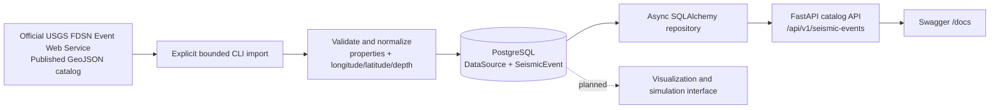

<div align="center">

# RESQ

**Earthquake Catalog Research & Simulation Foundation**

<a href="https://readme-typing-svg.demolab.com?font=Fira+Code&amp;weight=600&amp;size=20&amp;pause=1200&amp;color=58A6FF&amp;center=true&amp;vCenter=true&amp;width=760&amp;lines=Explore+published+seismic+catalog+data+responsibly;Async+catalog+API+%C2%B7+controlled+USGS+imports+%C2%B7+research+first">
  
</a>


`/\/\/\/\/\/\/\/\/\/\/\/\`


[](https://www.python.org/)
[](https://fastapi.tiangolo.com/)
[](https://www.postgresql.org/)
[](https://www.sqlalchemy.org/)
[](LICENSE)

</div>

> If the animated line is unavailable, the title and tagline above remain the project’s plain-text fallback.

> [!IMPORTANT]
> ResQ is a research and simulation prototype. It does **not** predict earthquakes, and it is not a deployed earthquake early-warning system. Its USGS integration imports already published catalog records; it is not a real-time seismic sensor feed.

## Overview

ResQ is an open-source backend foundation for collecting, storing, filtering, and studying public earthquake-catalog data. It is aimed at students, researchers, and developers who need a clearly bounded starting point for seismic-data exploration.

The current prototype provides a FastAPI catalog API, PostgreSQL persistence, and an explicitly triggered USGS FDSN GeoJSON import command. Simulations, operational alerting, and a web interface are not implemented yet.

## Why ResQ?

Earthquake data is easy to misrepresent. ResQ keeps provenance and scope visible: records are tied to a data source, imports require a finite time window, duplicate source events are avoided, and the API exposes stored catalog data rather than presenting it as a warning or prediction.

For source context and responsible-use guidance, see [data sources](docs/data-sources.md) and [architecture](docs/architecture.md).

## What is implemented

- Async FastAPI application with OpenAPI/Swagger documentation
- PostgreSQL persistence through SQLAlchemy 2.0 and Alembic
- Paginated seismic-event catalog API with time and magnitude filters
- Event detail lookup by internal UUID, including public source provenance
- Geographic bounding-box aggregates for stored catalog events
- Health and database-readiness endpoints
- Bounded, manual USGS FDSN Event Web Service import in GeoJSON format
- GeoJSON normalization, malformed-record skipping, and database-backed duplicate protection
- Offline unit tests with mocked HTTP responses
- Separate API, service, repository, model, and integration layers

## Data flow



The dashed component is planned. The USGS branch is catalog ingestion only—not a real-time detection or alert pipeline.

## Technology stack

| Area | Technology |
| --- | --- |
| Runtime | Python 3.12+ |
| API | FastAPI, Uvicorn |
| Validation & settings | Pydantic v2, pydantic-settings |
| Database | PostgreSQL, SQLAlchemy async, asyncpg |
| Migrations | Alembic |
| External catalog | USGS FDSN Event Web Service, GeoJSON |
| Testing & quality | Pytest, pytest-asyncio, Ruff |

## Project structure

```text
ResQ/
├── backend/
│   ├── alembic/             # Database migration history
│   ├── app/
│   │   ├── api/             # FastAPI route definitions
│   │   ├── cli/             # Explicit USGS import command
│   │   ├── integrations/    # USGS client and GeoJSON normalization
│   │   ├── models/          # SQLAlchemy DataSource and SeismicEvent models
│   │   ├── repositories/    # Database queries
│   │   ├── schemas/         # Pydantic API schemas
│   │   └── services/        # Catalog and ingestion workflows
│   └── tests/               # Unit tests
├── docs/                    # Architecture and data-source notes
├── frontend/                # Reserved for a future web client
├── LICENSE
└── README.md
```

## Getting started

### Prerequisites

- Python 3.12 or newer
- PostgreSQL
- PowerShell on Windows (commands below)

### Install and configure

From the repository root:

```powershell
cd backend
py -3.12 -m venv .venv
.\.venv\Scripts\Activate.ps1
python -m pip install --upgrade pip
python -m pip install -r requirements.txt
Copy-Item .env.example .env
```

Edit `backend/.env` for your local PostgreSQL installation. Do not commit this file. The application reads the following settings:

| Variable | Purpose |
| --- | --- |
| `RESQ_DATABASE_URL` | Async PostgreSQL connection URL using the `postgresql+asyncpg` scheme |
| `RESQ_USGS_BASE_URL` | USGS FDSN Event service base URL |
| `RESQ_LOG_LEVEL` | Application log level |

### Create the database and migrate

Create an empty local database, then apply the existing Alembic migration history:

```powershell
psql -U postgres -h localhost -c "CREATE DATABASE resq;"
alembic upgrade head
```

### Run the API and Swagger UI

Run this command **from `backend`**—the `app` package is located there:

```powershell
python -m uvicorn app.main:app --reload
```

Open [Swagger UI](http://127.0.0.1:8000/docs) to inspect and execute available endpoints. The page can load without PostgreSQL, but database-backed endpoints require a working connection and applied migrations.

## API

| Method | Endpoint | Description |
| --- | --- | --- |
| `GET` | `/api/v1/health` | Application health status |
| `GET` | `/api/v1/health/ready` | PostgreSQL connectivity check |
| `GET` | `/api/v1/seismic-events` | Stored event catalog with filters and pagination |
| `GET` | `/api/v1/seismic-events/{event_id}` | One stored event by internal UUID |
| `GET` | `/api/v1/analytics/summary` | Aggregate statistics for the stored catalog |
| `GET` | `/api/v1/analytics/geographic` | Aggregate observed catalog statistics within a bounding box |

`GET /api/v1/seismic-events` accepts:

| Parameter | Notes |
| --- | --- |
| `limit` | 1–100; defaults to 50 |
| `offset` | Zero-based pagination offset |
| `min_magnitude` | Magnitude filter from -2 to 10 |
| `start_time` | Offset-aware ISO 8601 timestamp |
| `end_time` | Offset-aware ISO 8601 timestamp; must not precede `start_time` |

Example:

```text
http://127.0.0.1:8000/api/v1/seismic-events?limit=20&min_magnitude=4&start_time=2025-01-01T00:00:00Z
```

`GET /api/v1/analytics/geographic` requires `south`, `north`, `west`, and
`east` WGS 84 decimal-degree bounds. Latitude bounds must satisfy `south <= north`.
When `west > east`, the requested box crosses the antimeridian. The response's
total includes all matching published catalog events; minimum, maximum, and
average magnitude exclude records with a missing magnitude, whose count is
returned separately. These are observed catalog statistics only: they do not
predict earthquakes or establish future risk.

Example:

```text
http://127.0.0.1:8000/api/v1/analytics/geographic?south=33&north=35&west=66&east=68
```

## Import a bounded USGS catalog range

After migrating the database, import a finite date range explicitly:

```powershell
python -m app.cli.ingest_usgs 2025-01-01T00:00:00Z 2025-01-02T00:00:00Z --min-magnitude 4.5
```

The command requests the official USGS catalog once for that range, normalizes valid features, and stores new events. It does not start polling, schedule recurring imports, or produce alerts.

## Testing and code quality

From `backend`:

```powershell
pytest -q
ruff check app tests --select F,I,UP
```

The test suite uses mocked HTTPX transports; it does not call the live USGS service.

## Roadmap

- Clearly labelled seismic simulation workflows
- Experimental research assessments
- Next.js map-based visualization client
- Carefully evaluated early-warning research workflows

## Scientific limitations and responsible use

- Catalog records describe detected, located, and published events—not predictions.
- Catalog ingestion is not equivalent to direct sensor telemetry or an operational early-warning feed.
- Data completeness, timing, and revisions remain properties of the upstream source.
- Any future simulation, assessment, or alert feature must be separately labelled and scientifically evaluated.

## Contributing

Contributions are welcome. Keep changes focused, preserve the research-only scope, add or update tests for behavior changes, and do not add claims that imply earthquake prediction or operational warning capability.

