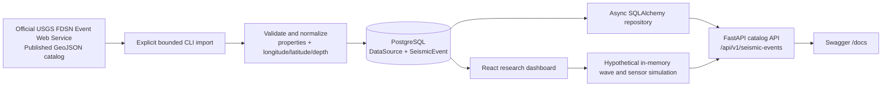

<div align="center">

# RESQ

**Earthquake Catalog Research & Simulation Foundation**

<a href="https://readme-typing-svg.demolab.com?font=Fira+Code&amp;weight=600&amp;size=20&amp;pause=1200&amp;color=58A6FF&amp;center=true&amp;vCenter=true&amp;width=760&amp;lines=Explore+published+seismic+catalog+data+responsibly;Async+catalog+API+%C2%B7+controlled+USGS+imports+%C2%B7+research+first">
  
</a>


`/\/\/\/\/\/\/\/\/\/\/\/\`


[](https://www.python.org/)
[](https://fastapi.tiangolo.com/)
[](https://www.postgresql.org/)
[](https://www.sqlalchemy.org/)
[](LICENSE)

</div>

> If the animated line is unavailable, the title and tagline above remain the project’s plain-text fallback.

> [!IMPORTANT]
> ResQ is a research and simulation prototype. It does **not** predict earthquakes, and it is not a deployed earthquake early-warning system. Its USGS integration imports already published catalog records; it is not a real-time seismic sensor feed.

## Overview

ResQ is an open-source research prototype for collecting, storing, filtering, and studying public earthquake-catalog data, alongside a separately labeled hypothetical early-warning simulation. It is aimed at students, researchers, and developers who need a clearly bounded starting point for seismic-data exploration.

The current prototype provides a FastAPI catalog API, PostgreSQL persistence, an explicitly triggered USGS FDSN GeoJSON import command, and a React map-based research interface. Its hypothetical propagation workflow is an educational mathematical simulation, not operational alerting or a validated EEW algorithm.

## Why ResQ?

Earthquake data is easy to misrepresent. ResQ keeps provenance and scope visible: records are tied to a data source, imports require a finite time window, duplicate source events are avoided, and the API exposes stored catalog data rather than presenting it as a warning or prediction.

For source context and responsible-use guidance, see [data sources](docs/data-sources.md) and [architecture](docs/architecture.md).

## What is implemented

- Async FastAPI application with OpenAPI/Swagger documentation
- PostgreSQL persistence through SQLAlchemy 2.0 and Alembic
- Paginated seismic-event catalog API with time and magnitude filters
- Event detail lookup by internal UUID, including public source provenance
- Geographic bounding-box aggregates for stored catalog events
- Read-only hypothetical earthquake scenarios compared with historical catalog proximity
- Deterministic, in-memory P- and S-wave propagation and synthetic-sensor timeline
- Interactive wavefront animation and target warning-lead-time calculations, explicitly labeled as research simulation
- Health and database-readiness endpoints
- Bounded, manual USGS FDSN Event Web Service import in GeoJSON format
- GeoJSON normalization, malformed-record skipping, and database-backed duplicate protection
- Offline unit tests with mocked HTTP responses
- Separate API, service, repository, model, and integration layers

## Data flow



The hypothetical simulation is a separate calculation path and does not read or write catalog data. The USGS branch remains catalog ingestion only—not a real-time detection or alert pipeline.

## Technology stack

| Area | Technology |
| --- | --- |
| Runtime | Python 3.12+ |
| API | FastAPI, Uvicorn |
| Validation & settings | Pydantic v2, pydantic-settings |
| Database | PostgreSQL, SQLAlchemy async, asyncpg |
| Migrations | Alembic |
| External catalog | USGS FDSN Event Web Service, GeoJSON |
| Testing & quality | Pytest, pytest-asyncio, Ruff |

## Project structure

```text
ResQ/
├── backend/
│   ├── alembic/             # Database migration history
│   ├── app/
│   │   ├── api/             # FastAPI route definitions
│   │   ├── cli/             # Explicit USGS import command
│   │   ├── integrations/    # USGS client and GeoJSON normalization
│   │   ├── models/          # SQLAlchemy DataSource and SeismicEvent models
│   │   ├── repositories/    # Database queries
│   │   ├── schemas/         # Pydantic API schemas
│   │   └── services/        # Catalog and ingestion workflows
│   └── tests/               # Unit tests
├── docs/                    # Architecture and data-source notes
├── frontend/                # React + TypeScript + Vite map and research dashboard
├── LICENSE
└── README.md
```

## Getting started

### Prerequisites

- Python 3.12 or newer
- PostgreSQL
- Node.js and npm (frontend)
- PowerShell on Windows (commands below)

### Install and configure

From the repository root:

```powershell
cd backend
py -3.12 -m venv .venv
.\.venv\Scripts\Activate.ps1
python -m pip install --upgrade pip
python -m pip install -r requirements.txt
Copy-Item .env.example .env
```

Edit `backend/.env` for your local PostgreSQL installation. Do not commit this file. The application reads the following settings:

| Variable | Purpose |
| --- | --- |
| `RESQ_DATABASE_URL` | Async PostgreSQL connection URL using the `postgresql+asyncpg` scheme |
| `RESQ_USGS_BASE_URL` | USGS FDSN Event service base URL |
| `RESQ_LOG_LEVEL` | Application log level |

### Create the database and migrate

Create an empty local database, then apply the existing Alembic migration history:

```powershell
psql -U postgres -h localhost -c "CREATE DATABASE resq;"
alembic upgrade head
```

### Run the API and Swagger UI

Run this command **from `backend`**—the `app` package is located there:

```powershell
python -m uvicorn app.main:app --reload
```

Open [Swagger UI](http://127.0.0.1:8000/docs) to inspect and execute available endpoints. The page can load without PostgreSQL, but database-backed endpoints require a working connection and applied migrations.

### Run the frontend

In a second terminal from the repository root:

```powershell
cd frontend
npm install
npm run dev
```

Open the local URL printed by Vite (normally `http://localhost:5173`). During local development, `/api` is proxied to `http://127.0.0.1:8000`; set `VITE_API_PROXY_TARGET` if the backend uses another address. The map's OpenStreetMap tiles require internet access. The early-warning simulation itself does not require PostgreSQL, imported catalog records, or external data.

## API

| Method | Endpoint | Description |
| --- | --- | --- |
| `GET` | `/api/v1/health` | Application health status |
| `GET` | `/api/v1/health/ready` | PostgreSQL connectivity check |
| `GET` | `/api/v1/seismic-events` | Stored event catalog with filters and pagination |
| `GET` | `/api/v1/seismic-events/{event_id}` | One stored event by internal UUID |
| `GET` | `/api/v1/analytics/summary` | Aggregate statistics for the stored catalog |
| `GET` | `/api/v1/analytics/geographic` | Aggregate observed catalog statistics within a bounding box |
| `POST` | `/api/v1/scenarios/earthquake` | Compare a hypothetical scenario with nearby historical catalog events |
| `POST` | `/api/v1/scenarios/early-warning` | Run an in-memory hypothetical wave and synthetic sensor simulation |

`GET /api/v1/seismic-events` accepts:

| Parameter | Notes |
| --- | --- |
| `limit` | 1–100; defaults to 50 |
| `offset` | Zero-based pagination offset |
| `min_magnitude` | Magnitude filter from -2 to 10 |
| `start_time` | Offset-aware ISO 8601 timestamp |
| `end_time` | Offset-aware ISO 8601 timestamp; must not precede `start_time` |

Example:

```text
http://127.0.0.1:8000/api/v1/seismic-events?limit=20&min_magnitude=4&start_time=2025-01-01T00:00:00Z
```

`GET /api/v1/analytics/geographic` requires `south`, `north`, `west`, and
`east` WGS 84 decimal-degree bounds. Latitude bounds must satisfy `south <= north`.
When `west > east`, the requested box crosses the antimeridian. The response's
total includes all matching published catalog events; minimum, maximum, and
average magnitude exclude records with a missing magnitude, whose count is
returned separately. These are observed catalog statistics only: they do not
predict earthquakes or establish future risk.

Example:

```text
http://127.0.0.1:8000/api/v1/analytics/geographic?south=33&north=35&west=66&east=68
```

`POST /api/v1/scenarios/earthquake` accepts a JSON body with `latitude`,
`longitude`, hypothetical `magnitude`, hypothetical `depth_km`, and `radius_km`.
It returns the hypothetical input unchanged and a separate aggregate of observed,
already-published catalog events within the radius. The scenario is never stored.
It is a research comparison only: proximity and magnitude do not predict future
earthquakes or establish ground shaking, damage, casualties, or operational risk.

### Early-warning research simulation

In the dashboard's **Hypothetical earthquake scenario** section, set epicenter coordinates, magnitude, and depth. Click the map in Epicenter mode to select coordinates. Configure sensor count, the number of processed sensors required for the modeled alert, sensor distribution radius, detection and processing delays, approximate P/S velocities, and one or more target coordinates. Example city coordinates are only editable demonstration locations. Run the simulation, then play, pause, or reset the model clock. The map, sensor states, modeled alert, and time remaining to each target's S-wave arrival advance from the API-returned timestamps.

`POST /api/v1/scenarios/early-warning` accepts epicenter `latitude` and `longitude` (WGS 84 degrees), `magnitude` (-2 to 10), `depth_km` (0 to 700), `detection_delay_seconds` and `processing_delay_seconds` (each 0 to 60), `sensor_count` (1 to 20), `required_sensor_count` (1 to sensor count), `sensor_radius_km` (greater than 0 through 1000), P velocity (3 to 8 km/s), S velocity (1.5 to 5 km/s and below P velocity), and 1 to 8 named target locations with valid latitude/longitude. Unknown fields, duplicate target names, and invalid values are rejected. Defaults are 8 sensors, a 2-sensor quorum, 250 km radius, 0.8 s detection delay, 0.5 s processing delay, and velocities 6 km/s (P) and 3.5 km/s (S).

For epicenter latitude/longitude $(\phi_1,\lambda_1)$ and target $(\phi_2,\lambda_2)$, surface distance uses the spherical haversine great-circle equation, with angles in radians and mean Earth radius $R=6371$ km:

$$a=\sin^2\left(\frac{\phi_2-\phi_1}{2}\right)+\cos(\phi_1)\cos(\phi_2)\sin^2\left(\frac{\lambda_2-\lambda_1}{2}\right),\quad d_{surface}=2R\arcsin(\sqrt{a})$$

Depth is incorporated with a local right-triangle approximation, $d_h=\sqrt{d_{surface}^2+depth^2}$, where the surface arc is treated as a horizontal distance. This is not an exact geocentric chord calculation or seismic ray tracing. Modeled direct-wave arrival time is $t_P=d_h/v_P$ or $t_S=d_h/v_S$. Surface distances use a spherical Earth and the model assumes constant approximate velocities; the configured magnitude is retained as scenario metadata but does not affect travel times or alert calculations.

Synthetic sensor locations use a deterministic golden-angle spiral: sensor $i$ (zero-based) is placed at radius $r_i=r_{max}\sqrt{(i+1)/N}$ and bearing $i\times2.399963$ radians from the epicenter. These points are illustrative, not verified locations or a representation of Afghanistan's monitoring infrastructure. Each sensor's modeled P detection is $t_{detect}=t_P+delay_{detect}$; its processed time is $t_{processed}=t_{detect}+delay_{processing}$. The API reports the earliest synthetic detection and the alert issuance time, which is the configured $k$th-smallest processed time, where $k$ is the required sensor quorum. This transparent order-statistic rule is not an operational detection algorithm.

For each target, modeled warning lead time is $L=t_S-t_{alert}$. Positive $L$ means only that this simplified model places alert issuance before modeled S-wave arrival; absolute values at or below $10^{-9}$ seconds are classified as zero and labeled **No useful lead time**; negative means the model places S-wave arrival before alert issuance. A negative value is not a warning delivered before shaking, and positive lead time is not a delivery or safety guarantee. Animated surface radii stop at the antipodal limit of the spherical distance model.

Real seismic waves travel through heterogeneous geological structures, and actual warning systems must address complex signal processing, station telemetry, communications, uncertainty, and alert delivery. This prototype does not model those factors, observed sensor readings, ground motion, damage, casualties, or a validated operational EEW algorithm. It does not detect actual earthquakes, provide operational earthquake warnings, or protect people. Its animation visualizes calculated model time only.

Example:

```json
{
  "latitude": 34.5,
  "longitude": 67.1,
  "magnitude": 5.8,
  "depth_km": 15,
  "radius_km": 100
}
```

## Import a bounded USGS catalog range

After migrating the database, import a finite date range explicitly:

```powershell
python -m app.cli.ingest_usgs 2025-01-01T00:00:00Z 2025-01-02T00:00:00Z --min-magnitude 4.5
```

The command requests the official USGS catalog once for that range, normalizes valid features, and stores new events. It does not start polling, schedule recurring imports, or produce alerts.

## Testing and code quality

From `backend`:

```powershell
pytest -q
ruff check app tests --select F,I,UP
```

The test suite uses mocked HTTPX transports; it does not call the live USGS service.

## Scientific limitations and responsible use

- Catalog records describe detected, located, and published events—not predictions.
- Catalog ingestion is not equivalent to direct sensor telemetry or an operational early-warning feed.
- Data completeness, timing, and revisions remain properties of the upstream source.
- The hypothetical simulation is not an operational early-warning service, earthquake prediction, or validated safety tool.
- Synthetic sensor markers are not real stations, and synthetic timing values are not measurements.
- Any future simulation, assessment, or alert feature must be separately labeled and scientifically evaluated.

## Contributing

Contributions are welcome. Keep changes focused, preserve the research-only scope, add or update tests for behavior changes, and do not add claims that imply earthquake prediction or operational warning capability.

